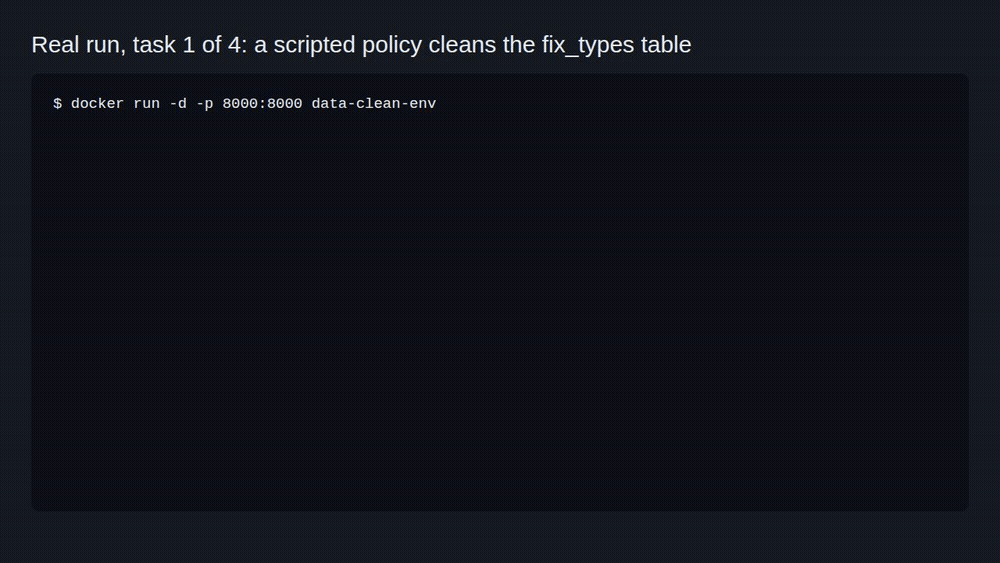

# DataCleanEnv



An OpenEnv environment where AI agents learn to clean messy tables, one action at a time.

```bash
docker build -t data-clean-env https://github.com/jayhemnani9910/data-clean-env.git && docker run --rm -p 8000:8000 data-clean-env
```

[](https://github.com/jayhemnani9910/data-clean-env/actions/workflows/ci.yml)

I built this for the Meta OpenEnv hackathon. Each episode hands the agent a small dirty table: numbers stored as words, mixed date formats, nulls, duplicate rows, bad casing, outliers. The agent fixes it with typed cleaning actions and gets rewarded for every grader check that starts passing.

## Try it

With the server from the line above running, solve all four tasks with a fixed list of actions. No model, no API key:

```bash
docker run --rm --network host data-clean-env python examples/scripted_policy.py
```

```
fix_types: 5 rows, score 0.01
  replace_value column=age old_value=thirty-five new_value=35        reward +0.10  score 0.11
  replace_value column=salary old_value=ninety thousand new_value=90000 reward +0.11  score 0.22
  convert_type column=id target_type=int                             reward +0.11  score 0.33
  convert_type column=age target_type=int                            reward +0.11  score 0.44
  convert_type column=salary target_type=int                         reward +0.11  score 0.56
  parse_date column=hire_date                                        reward +0.43  score 0.99
  9/9 checks pass
...
```

From your own Python code, use the client. It talks to the server over a WebSocket, so the episode keeps its state between steps:

```python
import asyncio
from client import DataCleanEnv
from models import DataCleanAction

async def main():
    env = DataCleanEnv(base_url="http://localhost:8000")
    await env.connect()
    result = await env.reset(task_name="fix_types")
    result = await env.step(DataCleanAction(action_type="convert_type", column="id", target_type="int"))
    print(result.observation.score, result.observation.last_action_result)
    await env.close()

asyncio.run(main())
```

Run that from a clone of this repo. The plain HTTP `/reset` and `/step` endpoints each build a fresh environment, so a `/step` after a `/reset` over HTTP answers "call reset() first". Use the client or `/ws` for whole episodes.

## How it works

`server/app.py` wraps `DataCleanEnvironment` with OpenEnv's `create_app`, which serves `/reset`, `/step`, `/state`, `/health`, `/schema` and `/ws` (up to 5 concurrent sessions).

On `reset`, the environment deep-copies the task's dirty table. On `step`, it applies one action to the rows, reruns the task's grader and returns the new table, per-column info (types, null count, unique count) and a reward.

The grader is a list of checks, such as "every `age` is an int" or "Bob Jones is 35". The score is the fraction that pass, clamped to 0.01..0.99 because the hackathon evaluator wanted scores strictly between 0 and 1. The reward for a step is the new score minus the old one, so an action that breaks the data gets a negative reward.

An episode ends when the score reaches 1.0 or the task's step limit runs out. With the clamp, the score tops out at 0.99, so in practice episodes run to the step limit.

## Tasks

The tables are small and made up by hand in `tasks/task_data.py`. Names and emails like `john@email.com` are placeholders.

| Task | Rows | Checks | Max steps | What's wrong |
|------|------|--------|-----------|--------------|
| `fix_types` | 5 | 9 | 15 | Employee records: ids like `"1.0"`, `"thirty-five"`, `"ninety thousand"`, three date formats |
| `handle_missing` | 10 | 6 | 20 | Product inventory: null prices and stock, empty descriptions, two duplicate rows, `electronics`/`ELECTRONICS` |
| `full_pipeline` | 15 | 12 | 25 | Customer orders: everything above plus a negative amount to drop and mixed-case emails and statuses |
| `outlier_cleanup` | 10 | 10 | 20 | Sales: padded product names, a monitor priced 50000.00, a negative price, a quantity of 100000, mixed-case currency and region |

Each task's description tells the agent what is wrong and gives hints.

## Actions

| `action_type` | Fields | What it does |
|---------------|--------|--------------|
| `replace_value` | `column`, `old_value`, `new_value` | Replace exact matches (compared as strings; the new value is parsed to int or float when it can be) |
| `convert_type` | `column`, `target_type` (`int`, `float`, `str`) | Convert a column, reporting values that failed |
| `fill_missing` | `column`, `value` | Fill `None` and empty strings |
| `remove_duplicates` | `subset_columns` (optional) | Keep the first row for each key |
| `drop_rows` | `row_indices` | Drop rows by current index |
| `standardize` | `column`, `method` (`lowercase`, `uppercase`, `trim`, `title_case`) | Change string formatting |
| `parse_date` | `column` | Turn `2023/01/15`, `01-15-2024`, `01/20/2024` and similar into `YYYY-MM-DD` |

## Observation

`task_name`, `task_description` (on reset only), `current_data` (list of row dicts), `column_info`, `row_count`, `total_issues`, `issues_fixed`, `score`, `last_action_result`, `reward`, `done`.

## LLM baseline

`inference.py` runs an OpenAI-compatible chat model through all four tasks and logs `[START]`, `[STEP]` and `[END]` lines in the hackathon's format. It needs a Hugging Face token. I have not rerun it for this README. Copy `.env.example` for the variables it reads.

```bash
export HF_TOKEN=...            # required
export MODEL_NAME=Qwen/Qwen2.5-72B-Instruct
export IMAGE_NAME=data-clean-env  # or leave unset and set ENV_BASE_URL
python inference.py
```

## Local development

```bash
git clone https://github.com/jayhemnani9910/data-clean-env.git data_clean_env && cd data_clean_env   # tests fail if the folder name has dashes
python3 -m venv .venv && . .venv/bin/activate
pip install -r requirements.txt pytest
uvicorn server.app:app --port 8000
python -m pytest -q
```

See [CONTRIBUTING.md](CONTRIBUTING.md).

## Layout

```
server/app.py                    FastAPI app via OpenEnv create_app
server/data_clean_environment.py actions, reset and step
tasks/task_data.py               dirty tables and graders
models.py                        DataCleanAction and DataCleanObservation
client.py                        OpenEnv client
inference.py                     LLM baseline
examples/scripted_policy.py      no-key scripted run
openenv.yaml                     OpenEnv spec
```

## License

MIT
